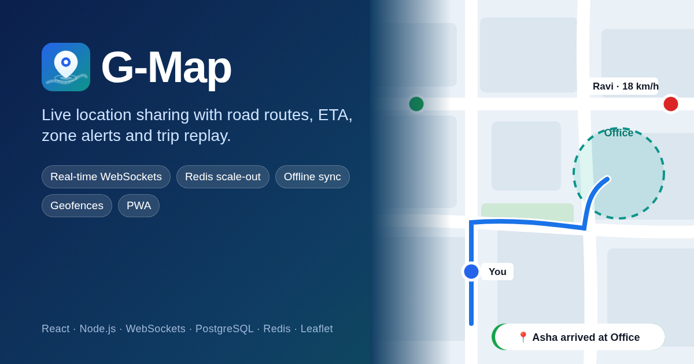
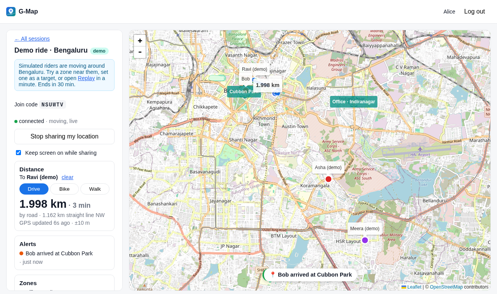
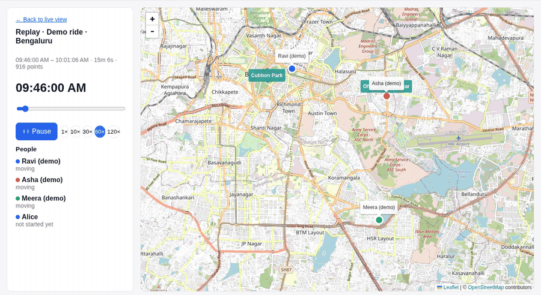
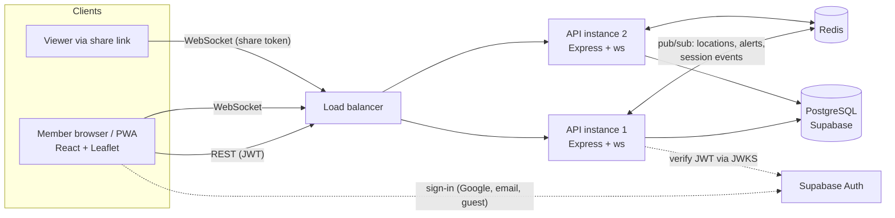

<p align="center">
  
</p>

<p align="center">
  <a href="https://live-location-tracker-amber.vercel.app/demo"><b>▶ Watch the live demo</b></a> (no sign-in)
  &nbsp;·&nbsp;
  <a href="https://live-location-tracker-amber.vercel.app">Open the app</a>
  &nbsp;·&nbsp;
  <a href="#architecture">Architecture</a>
  &nbsp;·&nbsp;
  <a href="#engineering-decisions">Engineering decisions</a>
</p>

<p align="center">
  <a href="https://github.com/tharunkumar171717/live-location-tracker/actions/workflows/ci.yml"></a>
  
  
  
  
  
</p>

# G-Map · Live Location Tracker

Share your live location with a group and see everyone move on one map, with
road routes and ETA to any member or point, alerts when someone arrives at or
leaves a place, view-only links for people without an account, and a replay of
the whole trip afterwards.

<p align="center">
  
</p>

## Try it in 30 seconds

- **[Watch the live demo](https://live-location-tracker-amber.vercel.app/demo)**: three simulated riders
  driving real Bengaluru roads in real time, with zone alerts as they pass. No sign-in.
- **Try as guest**: start your own session with the riders, add zones, set a rider as your
  target to get a road route and ETA, then open **Replay**.
- **Run it locally** with one command: `docker compose up --build`, then open http://localhost:3000/demo
  (Postgres, Redis, two API instances behind a load balancer, and the web app).

## Features

| | |
|---|---|
| **Live map** | Everyone in the session on one map, updated over WebSockets. Markers glide between GPS fixes using speed and heading (dead reckoning). |
| **Routes & ETA** | Road route, distance and ETA to a member or a point (drive / bike / walk via OSRM), re-routed when you go off course. |
| **Zones (geofences)** | Draw a circle on the map; members get "Asha arrived at Office" / "left Office" alerts in real time. |
| **View-only links** | Share a link that expires in 15 min to 24 h. No account needed; revocable; viewers can't send anything. |
| **Trip replay** | Scrub through a session's history at 1× to 120× with growing trails. |
| **Offline sync** | Points recorded without a connection are saved on the device and uploaded as one batch on reconnect, with no gaps in history. |
| **Battery saver** | Sends every 1.5 s while moving, only a heartbeat while standing still, and backs off when the tab is hidden. Optional screen wake lock. |
| **Installable PWA** | Add to home screen; app shell and recently viewed map tiles work offline. |
| **Demo mode** | Simulated riders on real roads, for a public demo and for guest sessions. |

<p align="center">
  
</p>

## Architecture



- **Web** (`web/`): React 19 + Vite, Leaflet/OpenStreetMap, Supabase Auth. Deployed on Vercel.
- **API** (`server/`): Express 5 REST + `ws` WebSocket hub, PostgreSQL via `pg`. Deployed on Render.
- **Bus** (`server/src/bus.js`): in-process by default; set `REDIS_URL` and every instance shares events.

Each socket sends `{type:"auth", token}` as its first message (never in the URL, so tokens stay out of
logs), joins per-session rooms, and streams `location` messages. Every message is validated by a
Zod schema ([`server/src/ws/protocol.js`](server/src/ws/protocol.js)).

## Engineering decisions

**Scaling WebSockets horizontally.** Rooms live in each instance's memory, so with two instances a
member on A wouldn't see a member on B. Every accepted event goes through a bus: an `EventEmitter` for
one instance, Redis pub/sub for many. The hub only subscribes, so producers don't know which one
they're using. A test starts two real instances on one Redis and checks that a location sent to one
reaches a socket on the other, and that it doesn't with the in-memory bus.

**Exactly-once zone alerts across instances.** "Inside / outside" per member and zone is flipped with a
conditional upsert (`… on conflict do update … where inside <> excluded.inside returning …`), so when
several instances process points concurrently, exactly one of them sees each transition. A buffer
band at the edge (hysteresis, widened for inaccurate fixes) stops GPS jitter from spamming alerts.

**Offline without data loss.** Points go to a per-session outbox in `localStorage` while
disconnected, then upload as `location_batch` messages that the server acknowledges (`batch_ack`). A
batch is only removed on its ack, so a drop mid-upload resends instead of losing points. The server
stores the whole batch for replay but broadcasts only the newest point, and never moves a marker
backwards.

**Security model.** Identity always comes from a verified JWT (Supabase JWKS / ES256), never from a
client-supplied id. Membership is re-checked on every write, so a removed member's old socket can't
keep posting. Non-members get 404 rather than 403, so session ids can't be probed. Share tokens are
24 random bytes, and only their SHA-256 hash is stored. Row-level security is on for every table as a
second line of defence.

**Abuse limits.** A token bucket per WebSocket connection (burst 20, 10/s, then disconnect after
repeated floods), per-user and per-IP HTTP limits with `Retry-After`, a 64 KB message cap, and per-user
throttling of stored points.

**Keeping the database bounded.** A retention job deletes points after 30 days, thins points older
than 7 days to one per user per minute (replay keeps the route shape), and cleans up demo data. It
works in small batches and takes a Postgres advisory lock so only one instance runs it.

**A demo that survives failover.** Simulated riders' positions are a pure function of wall-clock time
along pre-baked OSRM road loops, so every instance agrees where a rider is. Only the holder of a Redis
lease records points; if it dies, another instance takes the lease and the riders carry on without a
jump. The public demo pauses itself when nobody is watching.

**Observability.** Structured JSON logs (pino), `/health` (liveness) and `/ready` (database + bus), and
Prometheus metrics at `/metrics`: open sockets by kind, messages by type, points stored, rate-limit
rejections, geofence events, HTTP latency by route pattern.

## Testing

| Suite | What it covers | Runs on |
|---|---|---|
| **Server** (`server/tests`, Vitest, 53 tests) | Auth, membership, WebSocket protocol and validation, rooms, rate limits, offline batches, share links, geofence transitions, replay, retention, demo mode, **two instances over Redis** | Real PostgreSQL and Redis: embedded locally, service containers in CI |
| **Web unit** (`web/tests/unit`, Vitest) | Send policy, offline outbox, socket client (reconnect, backoff, batch ack) with a fake WebSocket, geo, route snapping, replay interpolation | Node |
| **End-to-end** (`web/tests/e2e`, Playwright) | Public demo; two signed-in browsers seeing each other, share link in a signed-out browser, zone alert when a member moves, replay; placing a zone on the map | Real browser + real API + database |

```sh
cd server && npm test           # starts Postgres and Redis for you, no Docker needed
cd web && npm test              # unit tests
cd web && npx playwright test   # end-to-end (starts API + web)
```

CI ([`.github/workflows/ci.yml`](.github/workflows/ci.yml)) runs lint, all three suites and the production build on every push.

## Run locally

**Everything in Docker** (demo and share pages work without any accounts):

```sh
docker compose up --build
open http://localhost:3000/demo
```

**Development** against your own Supabase project: see [docs/setup.md](docs/setup.md).

## Project structure

```
server/
  src/app.js              builds one instance: HTTP API, WebSocket hub, bus, demo, jobs
  src/bus.js              in-memory or Redis pub/sub event bus + leases
  src/ws/                 WebSocket hub and Zod protocol schemas
  src/services/           sessions, locations (+ offline batches), share links, geofences
  src/demo/               simulated riders and their baked road routes
  src/jobs/retention.js   history retention and downsampling
  db/migrations/          SQL migrations (Supabase); db/local/ = auth shim for plain Postgres
  tests/                  integration tests on real Postgres + Redis
web/
  src/pages/              dashboard, live session, replay, share view, demo
  src/tracking/           socket client, offline outbox, send policy, GPS, smoothing, routing
  src/components/         map, share links, zones, alerts
  tests/                  unit tests and Playwright E2E
deploy/nginx-lb.conf      load balancer for the two-instance compose stack
```

## Deployment

| Part | Host | Notes |
|---|---|---|
| Web | Vercel | root `web/`; SPA rewrites in `vercel.json` |
| API | Render | root `server/`; health check on `/ready` |
| Database + auth | Supabase | run `npm run migrate` from `server/` |
| Redis | optional | only needed for more than one API instance |

Vercel can't host the API: its functions don't keep WebSocket connections open.

---

Built by [Tharun Kumar](https://github.com/tharunkumar171717). Map data © OpenStreetMap contributors; routing by OSRM.
